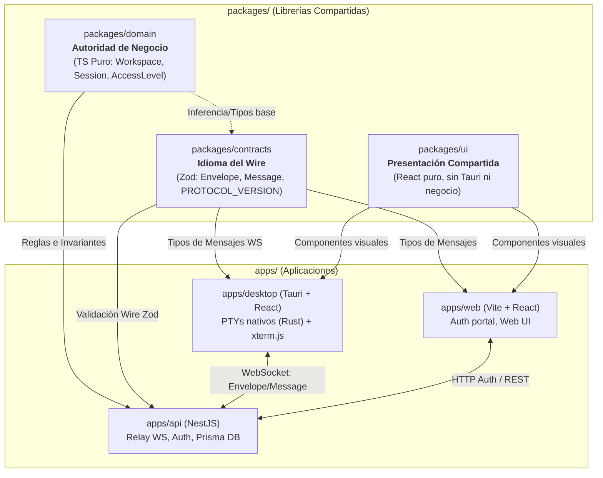

# OpenCollab

<div align="center">
  <p><strong>Espacio de trabajo unificado para agentes de IA en terminal con colaboración en tiempo real</strong></p>

  <a href="https://github.com/Gentleman-Programming/gentle-ai">
    
  </a>
</div>

---

## 📌 ¿Qué es OpenCollab?

**OpenCollab** es una aplicación de escritorio diseñada para centralizar, monitorear y compartir en tiempo real sesiones con agentes de IA basados en terminal (tales como Claude Code, OpenCode, Codex, Gemini CLI y shells convencionales) en una cuadrícula multipanel fluida.

### Características Principales

- **Grilla flexible de terminales:** Paneles dinámicos con renderizado acelerado mediante [xterm.js](https://xtermjs.org/) y PTY nativos gestionados en Rust.
- **Detección inteligente de agentes:** Inspección periódica de procesos hijos y hooks directos para identificar agentes activos y reportar su estado (Working, Idle, esperando aprobación, herramientas en curso).
- **Colaboración en tiempo real:**
  - **Workspaces y Sesiones:** Contenedores de proyecto y salas compartidas donde múltiples colaboradores observan la salida de las terminales.
  - **Control de acceso estricto:** Niveles jerárquicos `None < View < Write` verificados tanto en el servidor como de forma *fail-closed* en el host local.
- **Autenticación desacoplada y handoff:** Inicio de sesión seguro en la web vía proveedores OAuth (GitHub, Google) con traspaso al desktop mediante PKCE S256 y deep links `opencollab://`.

---

## 🏗️ Arquitectura y Estructura del Monorepo

El proyecto está organizado como un monorepo administrado con **pnpm workspaces** y **Turborepo**, siguiendo principios de arquitectura limpia con dependencias estrictas hacia el interior.

```text
opencollab/
├── apps/
│   ├── api/          # Servidor relay NestJS 11 (WebSocket, Auth, Prisma 7 + PostgreSQL)
│   ├── desktop/      # Aplicación de escritorio Tauri 2 (Frontend React 19 + Core nativo Rust)
│   └── web/          # Portal web y autenticación (Vite 8 + React 19)
├── packages/
│   ├── contracts/    # @opencollab/contracts: Schemas Zod y tipos del wire protocol
│   ├── domain/       # @opencollab/domain: Autoridad pura de negocio colaborativo en TypeScript
│   ├── ui/           # @opencollab/ui: Componentes visuales compartidos (Panel, Sidebar, etc.)
│   └── config/       # Configuraciones base de TypeScript y herramientas
└── docker-compose.yml
```

### Roles y Límites de Paquetes

- **`@opencollab/domain`**: Única autoridad de reglas colaborativas (Workspace, Session, Invitation, Permission). Cero dependencias externas en runtime.
- **`@opencollab/contracts`**: Esquema canónico del wire protocol con paridad de serialización con el núcleo Rust (`apps/desktop/core`).
- **`@opencollab/ui`**: Componentes presentacionales desacoplados de Tauri y de lógica de negocio.
- **Consumo de paquetes**: Las aplicaciones (`apps/*`) consumen las librerías compartidas estrictamente desde `@opencollab/*` a través de sus artefactos construidos (`dist/`).

### Flujo y Comunicación del Sistema



---

## ⚙️ Requisitos Previos

Para compilar y ejecutar el proyecto localmente, asegurate de tener instalado:

- **Node.js**: Versión 24.x LTS recomendada.
- **pnpm**: Versión 11 o superior (`corepack enable && corepack prepare pnpm@latest --activate`).
- **Rust**: Versión estable con `cargo` y los componentes `rustfmt` y `clippy` (`rustup update stable`).
- **Docker & Docker Compose**: Para ejecutar PostgreSQL y el entorno contenedorizado.
- **Dependencias de Tauri en Linux (si aplica)**: `libwebkit2gtk-4.1-dev`, `build-essential`, `curl`, `wget`, `file`, `libssl-dev`, `libgtk-3-dev`, `libayatana-appindicator3-dev`, `librsvg2-dev`.

---

## 🚀 Puesta en Marcha Local

### 1. Clonar el repositorio y configurar variables de entorno

```bash
git clone https://github.com/facyndev/opencollab.git
cd opencollab
cp .env.example .env
```

Editá el archivo `.env` para configurar tu `JWT_SECRET` (mínimo 32 caracteres) y, opcionalmente, credenciales OAuth para login con GitHub/Google.

### 2. Instalar dependencias

```bash
pnpm install
```
*(Nota: la instalación dispara automáticamente la generación del cliente Prisma en `apps/api`).*

### 3. Levantar la base de datos PostgreSQL

Podés iniciar una instancia de PostgreSQL en Docker:

```bash
docker compose up -d postgres
```

O si preferís levantar todo el backend (PostgreSQL + API + Web bajo Nginx en puerto 8080):

```bash
docker compose up -d --build
```

### 4. Ejecutar las aplicaciones en desarrollo

Podés correr los servicios individualmente según la parte en la que estés trabajando:

#### Desktop (Tauri)
```bash
# Frontend en el navegador (Vite)
pnpm dev

# Aplicación nativa de escritorio completa (perfil de desarrollo aislado)
pnpm desktop:dev
```

#### Servidor Relay / API (NestJS)
```bash
pnpm --filter @opencollab/server start:dev
```

#### Portal Web (Vite)
```bash
pnpm --filter @opencollab/web dev
```

---

## 🧪 Comprobación y Calidad de Código

El repositorio cuenta con pipelines automatizados de validación rápida y pruebas exhaustivas:

| Comando | Descripción |
|---|---|
| `pnpm test` | Ejecuta todos los tests unitarios en TypeScript (Vitest) |
| `pnpm typecheck` | Comprueba tipos en todos los proyectos del workspace (`tsc --noEmit`) |
| `pnpm build` | Compila todos los paquetes compartidos y aplicaciones |
| `pnpm check:rust` | Ejecuta formato (`cargo fmt`), linter (`clippy`) y tests unitarios de Rust |
| `pnpm pre-push` | Corre la suite integral de verificación rápida previa a git push |
| `pnpm --filter @opencollab/desktop test:e2e` | Ejecuta las pruebas E2E de interfaz de usuario con Chromium headless |

---

## 📄 Licencia

Este proyecto está bajo los términos y condiciones de la licencia definida en el repositorio.
