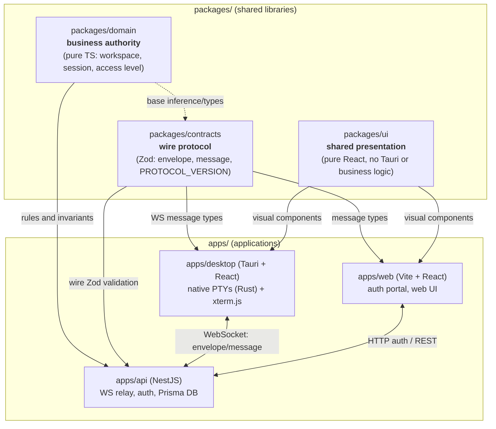

# OpenCollab

<div align="center">
  <p><strong>Unified workspace for terminal-based AI agents with real-time collaboration</strong></p>

  <a href="https://github.com/Gentleman-Programming/gentle-ai">
    
  </a>
</div>

---

## 📌 What is OpenCollab?

**OpenCollab** is a desktop application designed to centralize, monitor, and collaborate in real time with terminal-based AI agents (such as Claude Code, OpenCode, Codex, Gemini CLI, and standard shells) in a flexible multi-pane grid.

### Key features

- **Flexible terminal grid:** dynamic panes with accelerated rendering powered by [xterm.js](https://xtermjs.org/) and native PTYs managed in Rust.
- **Intelligent agent detection:** periodic inspection of child processes and direct hooks to detect active agents and report their lifecycle (working, idle, awaiting approval, running tools).
- **Real-time collaboration:**
  - **Workspaces and sessions:** project containers and shared rooms where multiple collaborators observe terminal streams.
  - **Strict access control:** hierarchical access levels (`none < view < write`) verified on the server and enforced fail-closed on the local host.
- **Decoupled authentication and handoff:** secure web sign-in via OAuth providers (GitHub, Google) with desktop handoff using PKCE S256 and `opencollab://` deep links.

---

## 🏗️ Architecture and monorepo structure

The project is organized as a monorepo managed with **pnpm workspaces** and **Turborepo**, following clean architecture principles with strict inward-pointing dependencies.

```text
opencollab/
├── apps/
│   ├── api/          # Relay server with NestJS 11 (WebSocket, auth, Prisma 7 + PostgreSQL)
│   ├── desktop/      # Desktop application with Tauri 2 (React 19 frontend + native Rust core)
│   └── web/          # Authentication portal and web client (Vite 8 + React 19)
├── packages/
│   ├── contracts/    # @opencollab/contracts: Zod wire schemas and protocol DTOs
│   ├── domain/       # @opencollab/domain: pure TypeScript collaborative business authority
│   ├── ui/           # @opencollab/ui: presentational components (Panel, Sidebar, etc.)
│   └── config/       # Shared TypeScript and tooling configurations
└── docker-compose.yml
```

### Package roles and boundaries

- **`@opencollab/domain`**: single authority for collaborative business rules (workspaces, sessions, invitations, permissions). Zero external runtime dependencies.
- **`@opencollab/contracts`**: canonical wire protocol schemas with byte parity to the Rust core (`apps/desktop/core`).
- **`@opencollab/ui`**: presentational components decoupled from Tauri and business logic.
- **Package consumption**: applications (`apps/*`) consume shared libraries strictly via `@opencollab/*` through their compiled output (`dist/`).

### System flow and communication



---

## ⚙️ Prerequisites

To build and run the project locally, make sure you have:

- **Node.js**: version 24.x LTS recommended.
- **pnpm**: version 11 or higher (`corepack enable && corepack prepare pnpm@latest --activate`).
- **Rust**: stable toolchain with `cargo`, `rustfmt`, and `clippy` (`rustup update stable`).
- **Docker and Docker Compose**: for running PostgreSQL and containerized services.
- **Linux Tauri dependencies (if applicable)**: `libwebkit2gtk-4.1-dev`, `build-essential`, `curl`, `wget`, `file`, `libssl-dev`, `libgtk-3-dev`, `libayatana-appindicator3-dev`, `librsvg2-dev`.

---

## 🚀 Getting started locally

### 1. Clone the repository and configure environment variables

```bash
git clone https://github.com/facyndev/opencollab.git
cd opencollab
cp .env.example .env
```

Edit the `.env` file to set your `JWT_SECRET` (at least 32 characters) and optional OAuth credentials for GitHub/Google sign-in.

### 2. Install dependencies

```bash
pnpm install
```
*(Note: installation automatically triggers Prisma client generation in `apps/api`).*

### 3. Start the PostgreSQL database

You can start a PostgreSQL instance with Docker:

```bash
docker compose up -d postgres
```

Or run the full stack (PostgreSQL + API + Web behind Nginx on port 8080):

```bash
docker compose up -d --build
```

### 4. Run applications in development mode

Run services individually depending on the area you are working on:

#### Desktop (Tauri)
```bash
# Frontend in the browser (Vite)
pnpm dev

# Native desktop app with an isolated dev profile
pnpm desktop:dev
```

#### Relay server / API (NestJS)
```bash
pnpm --filter @opencollab/server start:dev
```

#### Web portal (Vite)
```bash
pnpm --filter @opencollab/web dev
```

---

## 🧪 Testing and code quality

The repository includes automated validation pipelines and comprehensive test suites:

| Command | Description |
|---|---|
| `pnpm test` | Run all TypeScript unit tests (Vitest) |
| `pnpm typecheck` | Check types across all workspace projects (`tsc --noEmit`) |
| `pnpm build` | Build all shared packages and applications |
| `pnpm check:rust` | Run Rust formatting check (`cargo fmt`), linter (`clippy`), and unit tests |
| `pnpm pre-push` | Run the fast verification pipeline prior to git push |
| `pnpm --filter @opencollab/desktop test:e2e` | Run UI end-to-end tests with headless Chromium |
